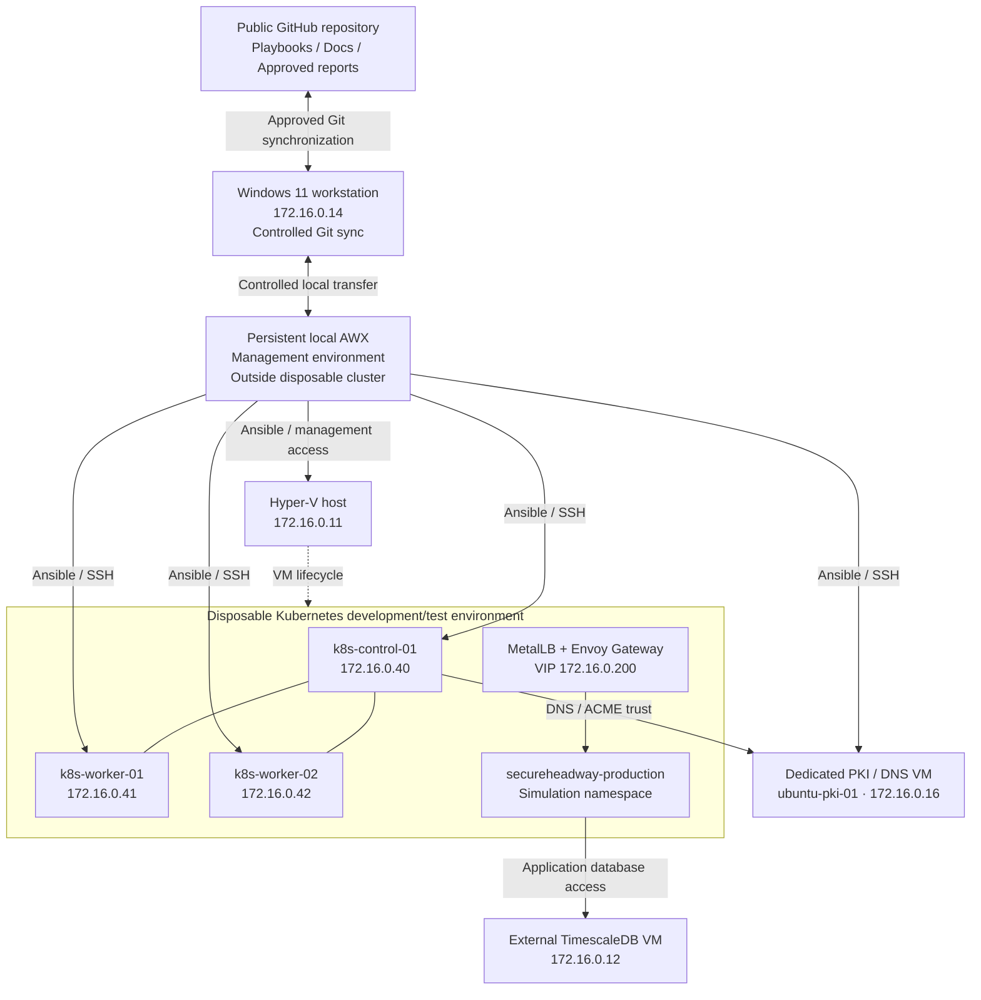
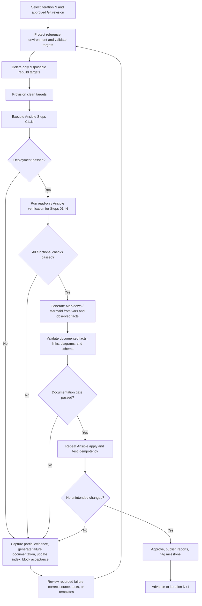
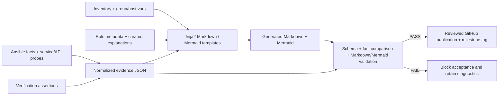
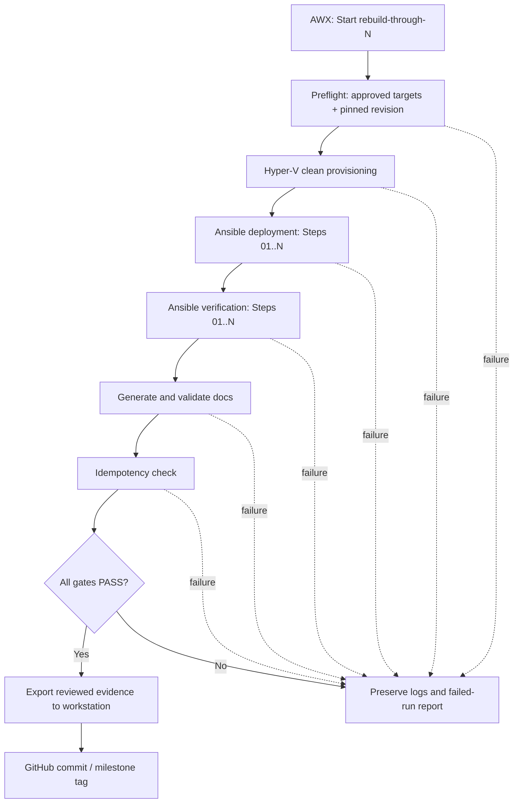

# Secure Headway Infrastructure Automation

## Ansible, AWX, Cumulative Rebuild, Verification, and Documentation — Implementation Approach

| Field | Value |
|---|---|
| Document ID | SH-INFRA-AUTO-001 |
| Status | **Planning / future implementation** — begin only after current infrastructure and PKI integration are complete |
| Document location | `secureheadway-infrastructure/documentation/SecureHeadway-Ansible-AWX-Implementation-Approach.md` |
| Project | Secure Headway — Staging and Production Setup and CI/CD Automation |
| Last updated | 2026-11-21 — documentation-first delivery requirements incorporated |
| Primary objective | Recreate the isolated Hyper-V Kubernetes development/test environment reproducibly from a clean baseline |
| Automation controller | Persistent local AWX, outside the disposable Kubernetes cluster |
| Source and review location | One public GitHub repository, with a controlled publishing path |

> **Scope note:** This is an implementation approach and acceptance plan, not a claim that the future Ansible automation or AWX platform is already deployed. Inventory examples and step boundaries are proposed and must be reconciled with the final, verified infrastructure documentation before implementation.

---

## 1. Executive overview

The project will convert the manually established Secure Headway development infrastructure into a repeatable, version-controlled automation system. A local AWX management environment will orchestrate Ansible jobs; Hyper-V/Windows provisioning and Ubuntu configuration will be automated; Ansible will verify the resulting infrastructure; and Jinja2 templates will generate Markdown documentation and Mermaid diagrams from both declared configuration and observed evidence.

The defining operating model is **cumulative clean rebuilds**:

- Iteration 1: build, verify, and document Step 01.
- Iteration 2: destroy the disposable test targets, then rebuild, verify, and document Steps 01–02.
- Iteration 3: destroy the disposable test targets, then rebuild, verify, and document Steps 01–03.
- Continue through Step N, always rebuilding **Steps 01 through N**, not merely installing the newest component.

Each iteration must prove functional correctness, reproducibility, documentation accuracy, and repeat execution without unintended configuration drift. Failed steps block advancement and retain diagnostic evidence.

### 1.1 Guiding principles

1. **Automate the rebuild, not just the first installation.** Avoid dependencies on undocumented manual state.
2. **Verify with Ansible.** Use native modules and assertions where possible; invoke specialized scripts from Ansible when necessary.
3. **Use observed evidence.** Documentation must distinguish *desired*, *observed*, and *verified* values.
4. **Preserve a working environment.** Initial destructive tests use disposable Hyper-V VMs and isolated test networks, never the current reference environment.
5. **Keep the controller persistent.** AWX, its execution dependencies, and evidence storage must survive cluster deletion.
6. **Stop on failures.** A failed prerequisite, deployment task, functional check, or documentation validation prevents progression.
7. **Publish reviewed evidence.** GitHub stores automation, Markdown/Mermaid documentation, and sanitized verification results with traceable revisions.
8. **Design for portability.** Explicitly distinguish portable Kubernetes configuration from Hyper-V-specific provisioning and EKS/GKE migration work.
9. **Treat documentation as a deliverable, not an afterthought.** Each step must capture observed state and produce validated documentation and reports as part of execution.
10. **Document failures too.** A failed deployment must still emit a partial checkpoint, diagnostics, and an index update; failure reports never imply acceptance.

### 1.2 Out of scope until separately approved

- Replacing or destroying the current manually configured environment.
- Deploying live production workloads on the local Kubernetes cluster.
- Implementing a full production backup/recovery program for the development-only environment.
- Starting Ansible/AWX implementation before the current PKI, DNS, certificate, and HTTPS integration phase is completed and documented.

---

## 2. Target infrastructure and responsibilities

### 2.1 Existing reference environment (to be revalidated at project kickoff)

| Component | Reference identity / address | Automation responsibility |
|---|---|---|
| Windows 11 development/build workstation | `172.16.0.14` | Git synchronization and controlled publication of reports |
| Hyper-V host | `172.16.0.11` | VM provisioning, virtual switches, virtual disks, lifecycle operations |
| Main LAN | `172.16.0.0/24` | Management connectivity and reference network |
| Kubernetes control plane | `k8s-control-01`, `172.16.0.40` | Ubuntu baseline, Kubernetes control plane, cluster add-ons |
| Kubernetes worker 1 | `k8s-worker-01`, `172.16.0.41` | Ubuntu baseline, Kubernetes worker |
| Kubernetes worker 2 | `k8s-worker-02`, `172.16.0.42` | Ubuntu baseline, Kubernetes worker |
| Standalone database VM | `timescaledbhost`, `172.16.0.12` | External PostgreSQL/TimescaleDB integration; rebuild scope to be confirmed |
| Dedicated PKI/DNS VM | `ubuntu-pki-01`, `172.16.0.16` | Smallstep CA, CoreDNS, CA trust, certificate integration |
| Kubernetes workload namespace | `secureheadway-production` | **Production simulation only**, not live production |
| Kubernetes service DNS | `10.96.0.10` (reference) | CoreDNS integration and functional DNS checks |
| Envoy Gateway VIP | `172.16.0.200` (reference) | Local ingress/load-balancer and TLS validation |
| AWX management environment | **New persistent management target; address TBD** | Job control, inventories, credentials, workflow history |

The earlier staging VM environment includes OPNsense and separate APP/DB/MGMT networks. Its inclusion in the **first** automation scope must be explicitly decided at kickoff; it is not silently assumed to be part of the disposable Kubernetes cluster. The development and earlier staging environments are not intended to operate concurrently.

### 2.2 Target topology



**Connectivity assumptions:** This diagram is logical, not a firewall or routing specification. Verify actual reachability and authentication paths before enabling each arrow. GitHub access is available from the workstation; it is **not** assumed available from AWX or the isolated Kubernetes VMs. Public GitHub does not grant ChatGPT direct access to local AWX or infrastructure.

### 2.3 Controller bootstrap and management boundary

AWX cannot be responsible for creating its own initial hosting environment from nothing. Use a small, version-controlled **bootstrap layer** (for example, PowerShell on the Windows workstation/Hyper-V host plus Ansible where feasible) to provision the persistent management target. Once AWX is running, import the remaining automation as AWX Projects, Inventories, Credentials, Job Templates, and Workflow Templates. The bootstrap layer must itself be documented, tested, and independently repeatable.

AWX must not run on the Kubernetes cluster that the workflow destroys. Do not delete the management VM, Git working copy, artifact store, or controller credentials during disposable-target cleanup.

---

## 3. Repository layout and conventions

The user-created top-level layout is retained. The following files/subdirectories are **proposed additions** within it.

```text
secureheadway-infrastructure/
├── ansible/
│   ├── inventories/
│   │   └── development/
│   │       ├── hosts.yml
│   │       ├── group_vars/
│   │       └── host_vars/
│   ├── playbooks/
│   │   ├── bootstrap-management.yml
│   │   ├── rebuild-through-step.yml
│   │   ├── deploy-environment.yml
│   │   ├── verify-environment.yml
│   │   ├── generate-documentation.yml
│   │   └── publish-reports.yml
│   ├── roles/
│   │   ├── ubuntu_baseline/
│   │   ├── networking/
│   │   ├── kubernetes_control_plane/
│   │   ├── kubernetes_worker/
│   │   ├── cluster_networking/
│   │   ├── cluster_storage/
│   │   ├── ingress_gateway/
│   │   ├── observability/
│   │   ├── pki_dns/
│   │   ├── certificate_management/
│   │   └── application_integration/
│   └── templates/
│       ├── markdown/
│       └── mermaid/
├── documentation/
│   ├── SecureHeadway-Ansible-AWX-Implementation-Approach.md
│   ├── current-state-index.md
│   ├── checkpoints/
│   ├── installation/
│   ├── architecture/
│   ├── configuration/
│   └── operations/
├── verification/
│   ├── step-01/
│   ├── step-02/
│   ├── step-03/
│   └── cumulative/
├── reports/
│   └── rebuild-history/
└── .github/
    └── workflows/
```

As additional steps are accepted, create corresponding `verification/step-NN/` directories. Role names above are logical groupings, not a commitment to one role per numbered step. A step may invoke several roles; a role may be reused by multiple steps.

### 3.1 Repository practices

- Store executable automation and documentation templates in Git; generate outputs deterministically.
- Pin Ansible collections, Python dependencies, Helm charts, container images, and critical package versions where feasible; record the resolved versions in reports.
- Use separate inventories for **reference**, **disposable rebuild**, and future **cloud simulation** targets as needed.
- Avoid hardcoding workstation-specific paths in roles. Supply environment-specific values through inventories and variables.
- Use meaningful commits and annotated milestone tags such as `rebuild-001`, `rebuild-002` only after accepted gates pass.
- Keep raw logs and potentially dangerous operational credentials in controlled local storage; publish selected reports. Internal development IP addresses and topology may be public by project choice, but **never publish live passwords, API tokens, private keys, or cloud credentials**.

---

## 4. Numbered implementation roadmap

**Sequencing rule:** Every numbered step contains four deliverables: (a) deployment automation, (b) Ansible-based verification, (c) generated/validated documentation, and (d) a successful cumulative clean rebuild through that step.

| Step | Step name | Primary tasks | Minimum acceptance evidence |
|---|---|---|---|
| **00** | **Baseline, scope, and automation control plane** | Freeze/reference the current working design; inventory assets and dependencies; establish public repository, Git workflow, persistent AWX management VM, bootstrap process, execution environment, and artifact export path. | AWX survives test-cluster deletion; inventory/repository sync works through the approved path; baseline and bootstrap runbook validated. |
| **01** | **Hyper-V disposable VM provisioning** | Define virtual switches/disks/VM sizing; automate disposable Ubuntu VM creation using PowerShell and Ubuntu autoinstall/cloud-init where applicable; ensure clean teardown. | New VMs created from a clean image with expected CPU, RAM, disk, NIC, and identity; teardown does not touch reference VMs. |
| **02** | **Ubuntu operating-system baseline** | Configure accounts, SSH keys, packages, time sync, hostname, OS settings, filesystem mounts, and systemd prerequisites. | Ansible verifies users, permissions, versions, services, mounts, and SSH access on all in-scope VMs. |
| **03** | **Network and name-resolution foundations** | Configure static addresses/routes and appropriate DNS clients; establish verified connectivity between management, nodes, PKI, and database. | Ansible tests addresses, routes, resolver behavior, required ports, and network isolation; no unintended internet routing. |
| **04** | **Kubernetes control-plane bootstrap** | Install pinned container runtime and Kubernetes components; initialize control plane; configure kubeconfig and API access. | Node Ready/control-plane health, API connectivity, versions, and certificates verified. |
| **05** | **Kubernetes worker enrollment** | Install runtime/Kubernetes components on workers; join workers; validate node inventory and scheduling. | All expected nodes Ready; scheduling and inter-node connectivity pass. |
| **06** | **Cluster networking and policies** | Install/configure Calico and namespace/network policies; validate pod-to-pod, pod-to-service, and restricted traffic. | Positive and negative network tests pass; policies match documented intent. |
| **07** | **Storage and persistence** | Deploy Longhorn (or approved equivalent), configure storage classes, test PVC lifecycle and restart behavior. | Dynamic provisioning, attach/mount, persistence, and recovery checks pass. |
| **08** | **Load balancing and gateway** | Configure MetalLB address pool and Envoy Gateway; provision HTTP listener/routing and local VIP. | Expected VIP, Gateway/Route conditions, HTTP routing, and allowed/denied paths pass. |
| **09** | **PKI and authoritative DNS** | Automate dedicated PKI VM services, CA hierarchy, Smallstep configuration, authoritative internal DNS, and CA trust distribution. | CA chain, CA service, DNS records, trust anchors, permissions, and service restart checks pass; root-key handling follows the final approved design. |
| **10** | **Cluster DNS and certificate lifecycle** | Add CoreDNS conditional forwarding; deploy/configure cert-manager; ACME issuer and HTTP-01 integration; certificate issuance/renewal tests. | Internal DNS and `cluster.local` both resolve; ACME issuance succeeds; issued chain and renewal behavior verified. |
| **11** | **HTTPS ingress and application connectivity** | Configure Envoy TLS listeners, certificates, HTTPS routes, application-to-database access, and namespace integration. | End-to-end HTTPS, trust, routing, application health, and DB connectivity pass. |
| **12** | **Observability and operational checks** | Install/verify Grafana, Loki, Alloy/log collectors, monitoring endpoints, and reboot/restart behavior. | Logs flow end-to-end; dashboards/datasources respond; representative restart checks pass. |
| **13** | **Application deployment and CI/CD integration** | Automate deployment of Web API and Next.js simulation workloads; integrate GitHub build artifacts and controlled promotion as approved. | Health checks, rollout/rollback, configuration injection, and application workflows pass. |
| **14** | **Full environment rebuild and portability review** | Run full clean-room rebuild; repeat idempotency/drift tests; finalize disaster-rebuild procedure for the test environment; document EKS/GKE migration deltas. | All cumulative gates PASS, complete report bundle, versioned milestone, and reviewed consolidated runbook. |

**Important:** Steps 09–11 must reflect the *actual* final PKI/HTTPS architecture established during the current manual phase. The order can be adjusted for prerequisites (for example, PKI trust may need to be provisioned earlier), but all previous steps remain in the cumulative verification scope. OPNsense/staging automation and standalone TimescaleDB rebuilding are optional additional workstreams until their boundaries are explicitly agreed.

---

## 5. Cumulative rebuild lifecycle

### 5.1 Iteration matrix

| Iteration | Disposable rebuild scope | Verification scope | Documentation scope |
|---|---|---|---|
| 01 | Step 01 | Step 01 | Step 01 + baseline |
| 02 | Steps 01–02 | Steps 01–02 | Consolidated Steps 01–02 |
| 03 | Steps 01–03 | Steps 01–03 | Consolidated Steps 01–03 |
| 04 | Steps 01–04 | Steps 01–04 | Consolidated Steps 01–04 |
| N | Steps 01–N | Steps 01–N | Consolidated Steps 01–N |

Step 00 is the persistent management/bootstrap prerequisite and is verified before each iteration; its management infrastructure is **not** destroyed as part of disposable cluster rebuilds.

### 5.2 Cumulative workflow



### 5.3 Required failure behavior

- Fail immediately when a critical prerequisite is missing; do not suppress failures to make a report appear green.
- Preserve logs and verification evidence **even if deployment fails** (use AWX workflow failure branches or Ansible `block`/`rescue`/`always` appropriately).
- A local manual repair is diagnostic only; it does **not** count as a successful rebuild. Commit the correction and rerun the complete cumulative sequence from clean targets.
- Separate **expected/allowed changes** (e.g., fresh machine IDs, certificate serials, timestamps) from unintended configuration drift.
- Publish a milestone tag only after all gates pass.

---

## 6. Ansible implementation strategy

### 6.1 Three automation layers

1. **Provisioning layer:** PowerShell/Hyper-V automation and Ubuntu unattended installation. Ansible may orchestrate PowerShell over an authorized Windows management endpoint, but the host must already be reachable and credentialed.
2. **Configuration layer:** Idempotent Ansible roles for OS, networking, Kubernetes, PKI, storage, ingress, observability, and application integration.
3. **Verification/documentation layer:** Independent read-only checks, evidence normalization, Jinja2 rendering, validation, and publication.

### 6.2 Role contract

Every infrastructure role should provide:

```text
roles/<role_name>/
├── defaults/main.yml       # Defaults; override through inventory
├── tasks/main.yml          # Declarative configuration
├── handlers/main.yml       # Controlled restarts/reloads
├── templates/              # Managed service configuration
├── files/                  # Non-secret static assets, if needed
├── meta/main.yml           # Dependencies and role metadata
└── verify/main.yml         # Read-only checks and assertions (proposed convention)
```

The `verify/main.yml` location is a **project convention**, not a built-in Ansible role entry point. The verification playbook must explicitly import/include it. Each verification should report the expected value, observed value, PASS/FAIL, host, step ID, and supporting evidence.

### 6.3 Verification module preferences

Use `ansible.builtin.assert`, `stat`, `service_facts`, `package_facts`, `setup`, `uri`, `wait_for`, `command` with `changed_when: false`, and Kubernetes-aware modules where appropriate. Run specialized scripts via `ansible.builtin.script` or `command` only where native modules are insufficient. Register results and assert their status; do not merely print output.

Example conceptual check:

```yaml
- name: Verify Smallstep CA service
  hosts: pki
  gather_facts: true
  tasks:
    - name: Collect service facts
      ansible.builtin.service_facts:

    - name: Assert CA is running
      ansible.builtin.assert:
        that:
          - ansible_facts.services['step-ca.service'].state == 'running'
        fail_msg: 'PKI verification failed: step-ca.service is not running'
        success_msg: 'PKI verification passed: step-ca.service is running'
```

For tests that modify state (e.g., creating a test PVC or issuing a test certificate), use isolated fixtures and explicit cleanup. Do not describe these as strictly read-only checks; distinguish non-destructive observation from controlled functional probes.

### 6.4 Idempotency and clean rebuild are separate gates

- **Clean rebuild:** From blank disposable targets, Steps 01..N produce the intended environment.
- **Idempotency:** Reapplying configuration to that environment produces no unintended changes.
- **Drift detection:** Independent verification detects changes outside the approved desired state.
- **Functional correctness:** The services actually perform their intended operations, not merely appear installed.

These are related but different tests. All are required.

---

## 7. Documentation-as-code strategy

### 7.0 Documentation-driven infrastructure delivery — mandatory contract

**Documentation is a first-class output of infrastructure delivery, not a retrospective task.** The manual implementation demonstrated that reconstructing commands, decisions, configuration, and failures from limited conversation history is unreliable. The Ansible implementation must capture these artifacts *during* each execution.

A numbered step is **not complete** until Ansible has deployed it, observed the resulting state, verified its behavior, generated the required Markdown/Mermaid and machine-readable reports, and validated documented claims against recorded evidence. This contract applies to the **entire cumulative Steps 01..N rebuild**, not only the newest step.

**Mandatory per-iteration outputs** (including failed iterations where feasible):

1. **Execution manifest:** iteration and step range, Git revision, AWX workflow/job identifiers, start/end timestamps and time zone, approved inventory, target identities, and artifact checksums.
2. **Exact execution record:** playbook/role/task identifiers, Ansible invocation and relevant parameters, delegated PowerShell/Bash commands, changed files/resources, return codes, and retained output references. Generated runbooks must not claim to reproduce literal commands if only task metadata was captured; provide the actual command or point to the source playbook and execution record.
3. **Observed configuration snapshot:** installed versions, IPs, services, ports, files, Kubernetes resources, and relevant actual configuration values, with explicit distinction between desired and observed values.
4. **Verification evidence:** expected and observed results, PASS/FAIL/NOT_RUN/NOT_APPLICABLE, timestamps, dependencies, and actionable failure details.
5. **Generated documentation:** installation, configuration, architecture, operations, Mermaid diagrams, and a cumulative current-state checkpoint appropriate to the iteration.
6. **Documentation validation report:** schema checks, fact-to-document comparisons, links, Markdown/Mermaid validation, completeness, and the exact Git revision of the templates and source.
7. **Index update:** a ready-to-commit `documentation/current-state-index.md` entry and refreshed Current Execution State, even when a run fails (marked FAIL or PARTIAL, never VERIFIED).

**Failure-path rule:** reporting is independent of deployment success. Use AWX success/failure workflow branches and/or Ansible `block`/`rescue`/`always` with a durable evidence store so an unsuccessful run still produces a partial diagnostic checkpoint. If a host is unreachable or facts cannot be collected, label them **UNAVAILABLE** or **NOT_RUN**; never invent observed values. Report-generation failure is itself a failed acceptance gate and must remain visible in AWX even if publication cannot complete.

**Acceptance invariant:** *No verified infrastructure without verified documentation; no accepted milestone without reproducible automation and retained execution evidence.*


### 7.1 Sources of documentation truth

| Source | Examples | Documentation role |
|---|---|---|
| Declared desired state | Inventory, `group_vars`, `host_vars`, role defaults, pinned versions | What Ansible intends to configure |
| Observed environment | Gathered facts, service state, version commands, API responses, DNS results | What was actually deployed |
| Verified evidence | Assertions, HTTP/DNS tests, Kubernetes conditions, connectivity checks | What was functionally proven |
| Curated explanation | Jinja2 prose templates and architecture decisions | Why it was designed this way and how to operate it |

**Never infer an installed version solely from a desired variable.** Documentation should explicitly distinguish intended and observed values and indicate when verification was not completed.

### 7.2 Generated artifacts

- **Installation runbook:** prerequisites, exact execution sequence, commands, dependencies, recovery steps.
- **Configuration reference:** host/role/service inventory, versions, ports, paths, settings, and observed state.
- **Architecture reference:** topology, trust boundaries, dependencies, Mermaid diagrams, Kubernetes portability notes.
- **Operations guide:** health checks, controlled restart, certificate renewal, logs, rollback, and troubleshooting.
- **Verification report:** per-step PASS/FAIL, expected/observed values, evidence references, revision, run ID, and timestamp.
- **Cumulative current-state checkpoint:** a timestamped, immutable snapshot of the accepted Steps 01..N, including deviations and corrective actions.

### 7.3 Generation pipeline



### 7.4 Documentation validation rules

1. Required sections and step IDs exist; references and relative links resolve.
2. Documented hostnames, IPs, services, ports, package versions, and paths match normalized observed facts, except for explicitly labeled planned values.
3. Mermaid syntax is checked with a compatible rendering/validation tool in CI or a local pipeline.
4. JSON evidence conforms to a versioned schema; missing checks are **NOT RUN**, not PASS.
5. Every factual PASS has an evidence record with command/module, target, observed value, and timestamp.
6. Generated files do not contain private keys, passwords, authentication tokens, or other credential material.
7. Markdown is regenerated after each accepted iteration; published changes are reviewable in Git.
8. Historical milestone artifacts are immutable; current consolidated documents may be updated.

### 7.5 Evidence record (illustrative schema)

```json
{
  "run_id": "rebuild-003-example",
  "git_revision": "<commit-sha>",
  "step_id": "03",
  "target": "k8s-control-01",
  "check_id": "dns.internal.resolution",
  "expected": "acme-test.secureheadway.internal resolves to 172.16.0.200",
  "observed": "172.16.0.200",
  "status": "PASS",
  "checked_at_utc": "<ISO-8601-timestamp>",
  "evidence_file": "verification/step-03/dns-check.json"
}
```

This is an example contract, not a real verification result. Avoid placing raw passwords or credentials in `observed` or evidence files.

### 7.6 Checkpoint index, naming, and daily continuity

Maintain `documentation/current-state-index.md` as the authoritative chronological index and daily resume pointer. It includes an **Overview**, **Current Execution State** (workstream, last accepted step, latest verified checkpoint, next action, open issues, approach revision, updated timestamp), **Status Definitions**, and **Index of Checkpoint Documents**.

Use the established checkpoint filename convention for new files:

`SecureHeadway_K8S_<Milestone>_YYYY-MM-DD_HHMM.md`

Example: `SecureHeadway_K8S_Observability_Verified_2026-11-14_1135.md`. The `SecureHeadway_K8S` prefix is retained consistently across Hyper-V, PKI, Kubernetes, and AWX workstreams. Preserve historical filenames even if they used different patterns; do not break existing links. If two new checkpoints fall within the same minute, add a collision-safe suffix rather than overwrite a file. Record the time zone explicitly in checkpoint metadata and prefer UTC for machine-readable timestamps.

Each checkpoint records target VM identity/OS/IP, exact commands or Ansible task and invocation references, observed output, changes, verification statuses, failures/corrections, diagrams when applicable, cloud portability notes, source revision, and documentation validation outcome.

For **every** milestone, generate **both** the timestamped checkpoint and its corresponding Markdown index entry, including a concise milestone description and one status: `VERIFIED` (all acceptance evidence complete), `PASS` (specified test passed), `PARTIAL` (incomplete), `PENDING` (not yet run), or `FAIL` (failed). Distinguish overall milestone status from individual test statuses. Update the Current Execution State after the run; never advance the *last accepted step* for a failed iteration. Validate that every index link resolves and that no historical checkpoint is overwritten.

**Daily session baseline:** review this Implementation Approach, `current-state-index.md`, and the latest relevant checkpoint before resuming. At session end, reconcile the index and create a new timestamped checkpoint where work or verified state changed. Record the Implementation Approach Git commit in each checkpoint to link execution to the governing requirements.


---

## 8. AWX orchestration and GitHub integration

### 8.1 AWX objects

| AWX object | Proposed use |
|---|---|
| Organization / Team | Secure Headway automation access boundaries |
| Project | Git-tracked automation source, synchronized through approved local Git transfer or direct access if available |
| Inventory | Disposable rebuild targets, persistent management targets, reference-only hosts |
| Credentials | SSH/WinRM, privilege escalation, API authentication; stored in AWX, not committed |
| Execution Environment | Pinned Ansible and collections for reproducible execution |
| Job Templates | Provision, deploy, verify, document, export evidence |
| Workflow Template | Ordered cumulative rebuild with success/failure branches |
| Schedules | Optional recurring non-destructive verification after the environment is established |
| API / Job history | Machine-readable execution status and audit trail |

### 8.2 AWX workflow



**Implementation detail:** AWX job success alone is insufficient. The workflow must consume explicit verification and documentation gate results. Failed deployment jobs should still trigger evidence collection.

### 8.3 GitHub publication without exposing local AWX

The Windows 11 workstation has outbound GitHub access. It can serve as a controlled synchronization bridge:

1. Fetch approved source changes from GitHub to a local working copy.
2. Make those sources available to AWX through an approved local Git mirror, mounted checkout, or other tested mechanism.
3. AWX executes against isolated targets and writes a local evidence bundle.
4. Workstation retrieves the evidence bundle, validates/redacts credentials, and commits selected Markdown, Mermaid, JSON, and summaries to GitHub.
5. A public repository URL allows remote review of published evidence **on demand**, but does not permit direct access to AWX or the private network.

Do not assume that GitHub Actions runners can reach local VMs. GitHub Actions should handle repository-level checks (YAML lint, Ansible syntax/lint with dependencies, Markdown, Mermaid, schemas, secret scanning); local AWX handles real infrastructure verification.

---

## 9. Quality gates and definition of done

A numbered step is **DONE** only if all gates below pass in a fresh cumulative rebuild. Documentation/reporting is part of delivery, not deferred cleanup; failed runs must still produce best-effort diagnostic documentation and an index entry.

| Gate | Required outcome |
|---|---|
| G0 — Safety / preflight | Approved target inventory, immutable source revision, and clean-target isolation verified |
| G1 — Provisioning | Disposable targets created from approved clean images |
| G2 — Deployment | All Steps 01..N complete with no unhandled failures |
| G3 — Configuration verification | Desired settings match observed service, OS, and cluster state |
| G4 — Functional verification | Positive/negative behavior and dependency tests pass |
| G5 — Documentation verification | Required Markdown/Mermaid, checkpoint, index entry, and structured reports were generated; documented claims agree with observed evidence |
| G6 — Idempotency | Reapplication causes no unintended changes |
| G7 — Publication | Reports archived, milestone tagged, and consolidated documentation updated |

A report must distinguish `PASS`, `FAIL`, `NOT_RUN`, and `NOT_APPLICABLE`. Missing evidence must never be silently treated as success. Require explicit approval before any destructive operation on targets outside the disposable rebuild inventory.

### 9.1 Milestone acceptance record

Each accepted milestone should include:

- Iteration number and cumulative step range.
- Git commit SHA, dependency lock versions, AWX job/workflow IDs.
- Target inventory, OS/container/Kubernetes/component versions, and timestamps.
- Per-check expected vs observed results, evidence references, and status.
- Documentation validation results and checksum/commit linkage.
- Idempotency summary, known limitations, approved deviations, and reviewer sign-off.

---

## 10. Cloud portability and future production considerations

The local cluster is a **development/testing simulation**, even when its namespace is named `secureheadway-production`. For each component, document:

| Area | Kubernetes-portable | Hyper-V/local-specific | Future AWS EKS / Google GKE consideration |
|---|---|---|---|
| Workloads | Deployments, Services, ConfigMaps, probes, many policies | Local VM addressing and host mounts | Managed identities, image registry, cloud networking, rollout strategy |
| Networking | Service discovery, policy intent, Gateway API resources where supported | Calico installation details, MetalLB LAN VIP, local routes | Managed CNI, cloud load balancer, Gateway controller and policy compatibility |
| Storage | PVC concepts, StorageClasses as interfaces | Longhorn disks and node layout | EBS/EFS or Persistent Disk/Filestore CSI classes, backup strategy |
| Certificates | cert-manager resources, trust principles | Internal Smallstep CA, CoreDNS zone, local ACME reachability | Managed DNS, public/private CA choice, DNS-01/HTTP-01 feasibility, trust distribution |
| Observability | OpenTelemetry/logging concepts, Grafana/Loki components | Local retention/storage/endpoint configuration | Managed logging, IAM, scalable storage, alerting |
| Provisioning | Ansible validation patterns and app configuration | PowerShell, Hyper-V, Ubuntu autoinstall | Terraform/cloud provisioning, managed Kubernetes node lifecycle |

Cloud production will require separate security, resilience, scaling, backup, availability, and cost design; passing local simulation tests is not equivalent to production readiness.

---

## 11. Risks, dependencies, and decisions to resolve

| Topic | Decision / mitigation |
|---|---|
| Current-phase completion | Do not begin the Ansible rebuild project until PKI/DNS/cert-manager/HTTPS manual integration is verified and documented. |
| Final source of truth | Reconcile all current-state runbooks with live facts at kickoff; do not encode stale addresses, versions, or service paths. |
| AWX bootstrap | Define persistent management host, installation method, local Git sync, and restoration procedure before Step 01. |
| Hyper-V control | Decide PowerShell remoting method, permissions, and safe target allowlists. |
| Disposable resources | Define non-overlapping VM names, MACs, disks, IPs, and teardown safeguards. |
| PKI root key | Confirm approved root key lifecycle, trust bootstrapping, and whether root operations remain manual/offline. |
| External TimescaleDB | Decide whether to automate DB VM creation or only validate connectivity and schema in initial scope. |
| Earlier staging/OPNsense environment | Decide whether it is a separate later automation workstream. |
| Rebuild time | Measure iteration duration; optimize only after preserving clean-rebuild rigor. |
| Public repository | Review every export for credentials; public infrastructure topology is acceptable by project decision. |
| Historical evidence | Store large/raw logs locally if needed; publish concise, traceable reports and durable artifact references. |
| Documentation verification | Establish a versioned evidence schema and automated cross-checks before the first accepted milestone. |

---

## 12. Project initiation checklist — after current phase closes

- [ ] Current infrastructure/PKI/HTTPS integration completed and verified.
- [ ] Final reference runbooks, diagrams, versions, and network inventory available.
- [ ] Confirm exact first-wave rebuild scope (Kubernetes VMs, PKI VM, external DB, staging/OPNsense).
- [ ] Choose and provision persistent AWX management host and bootstrap process.
- [ ] Verify Windows-to-GitHub and Windows-to-AWX controlled synchronization.
- [ ] Establish safe disposable Hyper-V VM inventory and teardown protection.
- [ ] Establish Ansible execution environment and pinned dependency versions.
- [ ] Approve evidence schema, Markdown templates, Mermaid validation, and failure gates.
- [ ] Implement Step 01, perform clean rebuild, verify, document, and tag `rebuild-001`.
- [ ] Proceed to Step 02 only after Step 01 acceptance; then rebuild Steps 01–02 from clean targets.

---

## 13. Final success criteria

The automation initiative succeeds when a new operator, starting with documented prerequisites and an approved clean baseline, can:

1. Bootstrap the persistent management tooling without relying on undocumented configuration.
2. Execute a complete clean rebuild of the Secure Headway development environment using the versioned automation.
3. Obtain Ansible-generated evidence proving that all required infrastructure and application functions work.
4. Generate complete Markdown/Mermaid runbooks whose machine-checkable claims agree with observed infrastructure facts.
5. Repeat the configuration without unintended changes and diagnose any failures from retained AWX/report evidence.
6. Reproduce a previous accepted milestone from its Git revision and dependency locks.
7. Explain what is reusable in Kubernetes and what must change for AWS EKS or Google GKE.

**Operating rule:** *Build cumulatively. Verify cumulatively. Document from evidence. Rebuild cleanly. Advance only on PASS.*

---

## AWX management platform decisions — 2026-11-22

**Status: Architecture approved / implementation pending.** These decisions supersede earlier TBD fields for AWX hosting, but do not constitute deployment evidence.

### Dedicated management VM

| Property | Approved design |
|---|---|
| VM | `ubuntu-awx-01` |
| Hyper-V host | `172.16.0.11` |
| Hyper-V network | `Public Virtual Switch` (External), Main LAN `172.16.0.0/24` |
| Static IP | `172.16.0.17/24` (user confirmed available/reserved) |
| Static MAC | `00-15-5D-28-40-14` (user confirmed reserved) |
| Gateway | `172.16.0.1` |
| OPNsense | Not part of AWX hosting or its management network design |
| OS | Ubuntu Server 24.04 LTS |
| Kubernetes | Dedicated persistent single-node K3s, separate from disposable kubeadm cluster |
| AWX | AWX Operator-managed deployment |
| PostgreSQL | AWX-only database, Operator-managed inside K3s |
| Sizing | 4 vCPU and 12 GiB RAM proposed; **approved disks: 80 GB OS/K3s/AWX and 40 GB AWX-only PostgreSQL (120 GB total)** |
| Status | **Two-disk allocation approved 2026-11-22**; CPU/RAM and implementation details to validate before provisioning |

The separate PostgreSQL disk is **not automatically persistent across a K3s rebuild**. Define and test local-path/PVC placement, database backup, AWX secret-key preservation, and restore procedures. AWX bootstrap/recovery must work without AWX itself. No application market-data workloads will share AWX PostgreSQL.

### GitHub documentation, verification evidence, and cost policy

The public `secureheadway-infrastructure` Git repository is the **version-controlled permanent record** for approved automation, Markdown documentation, Mermaid diagrams, and compact sanitized PASS/FAIL verification evidence. Publish cumulative rebuild summaries and a traceable index update for every iteration, including failed/partial iterations.

- Commit text-based Ansible YAML, documentation, compact JSON verification results, and sanitized summaries.
- Retain detailed AWX job output locally in AWX for a bounded period; **30–90 days is a proposed starting range**, to be confirmed and implemented as a retention policy.
- Do not commit raw verbose logs, VM/VHD images, PostgreSQL backups, binary archives, or large diagnostics to Git.
- Avoid Git LFS and unnecessary GitHub Actions artifact/package storage; verify plan-specific billing and quotas before enabling metered services. Set cost alerts/budgets for metered services where available.
- Never publish passwords, API tokens, SSH/private keys, AWX encryption secrets, sensitive certificate material, or unsanitized outputs. Apply automated secret scanning and publication approval before GitHub push.
- Use a controlled publishing route from AWX/local evidence storage through the authorized GitHub sync mechanism; do not assume direct GitHub connectivity from every managed host.
- Record report checksums, source Git revision, job identifiers, verification status, and observed-versus-desired state. Fail documentation/publication acceptance gates if required evidence is missing.
- Repository growth must be monitored because Git history retains previous versions; do not assume text storage is literally unlimited or free for every GitHub feature.

### Completed planning verification

**AWX-001 — Hyper-V VM network-adapter inventory: PASS (user-supplied output).** Inventory covered 11 VMs and 14 network adapters. Existing static MACs `00-15-5D-28-40-10` through `00-15-5D-28-40-13` were observed; proposed AWX MAC `00-15-5D-28-40-14` was absent from the provided inventory and subsequently confirmed reserved by the user. This is planning evidence only, not evidence that the AWX VM exists.

**Next step:** AWX-002, implement the approved two-disk layout, verify dedicated PostgreSQL PVC placement on Disk 2, and create `ubuntu-awx-01`; capture actual Hyper-V configuration and verification before marking complete.
